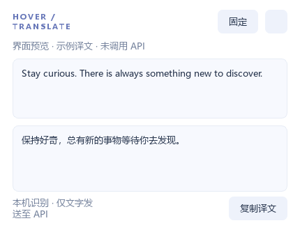

<p align="center"></p>

# HoverTranslate · 悬停与选中翻译

[](https://github.com/zijichiji0114-code/HoverTranslate/actions/workflows/windows.yml)
[](LICENSE)


**按住快捷键悬停取词，或选中文字后翻译。截图留在本机，译文显示在鼠标附近。**

A Windows desktop translator with local OCR, selected-text capture, and streaming LLM translation.

Windows 10/11 桌面程序。支持“悬停＋快捷键”和“选中文字＋快捷键”，调用你配置的大模型 API 翻译，在鼠标附近显示译文。默认同时启用两种方式，也可单独启用其中一种。当前版本为 1.1.1。

## 直接运行

从 [GitHub Releases](https://github.com/zijichiji0114-code/HoverTranslate/releases/latest) 下载 Windows x64 便携包，解压后双击 `HoverTranslate.exe`，无需安装 Python。**整个程序文件夹必须一起保留**，不能只复制 exe。当前版本为 **1.1.1**。

| 方式 | 默认快捷键 | 使用方法 |
|---|---|---|
| 悬停翻译 | `Ctrl + Alt` | 按住组合键，将鼠标停在文字上约 0.5 秒 |
| 选中翻译 | `Ctrl + Shift + F8` | 先选中文字，再按一次组合键并松开 |

两种方式默认同时启用，支持独立修改快捷键。浮窗会避开屏幕边缘，支持固定、复制、Esc 关闭和托盘运行。



1. 在设置里填写 Base URL、模型名称、API Key，选择目标语言。
2. 点击“测试 API”，确认服务能返回示例文字的译文，再点击“保存并启用”。测试会产生一次很小的 API 请求。
3. **悬停方式：按住 Ctrl + Alt**，把鼠标停在文字上约 0.5 秒。程序自动 OCR 并用浅紫色边框标出取词范围。
4. **选中方式：先在其他应用中选中文字，再按一次 Ctrl + Shift + F8 并松开按键。**程序优先直接读取选中文字；失败时按设置使用兼容复制取词。两种方式均在鼠标附近流式显示译文。
5. 移入浮窗可选择原文和译文，或点击“复制译文”。鼠标离开原文范围和浮窗后约 0.18 秒自动关闭，无需松开快捷键；从原文移向浮窗时会留出短暂过渡时间。Esc 随时关闭；点击“固定”可持续保留。固定时暂停新的悬停取词，关闭浮窗后恢复。移开时会取消未完成的任务，迟到的译文不会重新弹出。
6. 关闭设置窗口后程序留在系统托盘，双击“译”图标打开设置，右键可暂停或退出。

设置中的“翻译方式”可以选择“两种方式同时启用”“仅悬停 + 快捷键”或“仅选中 + 快捷键”。悬停快捷键可改为 Ctrl + Shift 或 Alt + Shift；选中快捷键可改为 Ctrl + Alt + T 或 Alt + F8。某些应用有同名快捷键，可以在设置里更换。程序通过检测按键触发，不会屏蔽其他应用的快捷键。

选中模式优先使用 Windows UI Automation 读取当前焦点控件的非空选区，不使用 OCR。兼容取词会在确认原窗口仍在前台、快捷键已松开后发送一次 Ctrl+C，等待剪贴板实际更新；不会把剪贴板原有内容误当作选中文字。读取后尽力恢复原有文本、HTML、图片等 Qt 可访问的 MIME 数据；应用私有的 OLE/延迟渲染格式不保证完整恢复，剪贴板历史工具也可能记录这次临时复制。可关闭“兼容取词”以完全避免自动复制。不支持复制或无障碍取词的应用会显示提示，可改用悬停方式。每次最多选中 6000 字。

## API 配置

使用支持 Chat Completions 的兼容接口，支持标准 SSE 流式响应和普通 JSON 响应。

| 服务 | Base URL | 模型 |
|---|---|---|
| DeepSeek | `https://api.deepseek.com` | `deepseek-chat` |
| 其他兼容服务 | 服务商提供的地址，通常以 `/v1` 结尾 | 服务商实际开放的模型名称 |
| Ollama | `http://localhost:11434/v1` | 本机已经安装的模型，例如 `qwen2.5:7b` |

地址会自动追加 `/chat/completions`；也允许填写完整接口地址。远程服务要求 HTTPS，本机 localhost/127.0.0.1/::1 允许 HTTP。本机 Ollama 可不填密钥；程序不会安装或启动 Ollama，也不会自动下载大语言模型。

你也可以通过 `HOVERTRANSLATE_API_KEY` 环境变量提供密钥。API Key 使用 Windows DPAPI 加密，存入当前账户的 `%APPDATA%\HoverTranslate\settings.json`。该配置文件不能跨 Windows 账户直接复用密钥。切换服务预设会清空密钥输入框，避免把旧服务的密钥发给新服务。

## 识别和浮窗行为

- 默认选取鼠标所在行；“附近段落”按行距及横向重叠扩展，最多 8 行，仅限当前识别区域。
- 识别区域默认 900 × 260 个物理像素，可调整。较长的行如果被区域边界截断，应增加宽度或移动鼠标。
- 文字在本机用 RapidOCR + ONNX Runtime CPU 模型识别，模型包含在程序内。**截图不上传**，只有识别出的原文发送给配置的 API。
- 浮窗根据鼠标所在显示器的工作区域选择右下、左下、右上或左上位置，避免越过边缘和任务栏。识别使用物理坐标，浮窗使用 Qt 逻辑坐标，按显示器映射，支持负坐标和混合缩放的坐标计算。
- OCR 支持常见中英文文字，较小字号、复杂背景、特殊字体、旋转文字和受保护画面可能无法识别。当前版本没有手动拖拽框选，也不会自动滚屏或识别屏幕外文字。
- 悬停取词仅在按住组合键并停留时触发；选中取词每次按下快捷键只触发一次。移动会取消旧的悬停任务，迟到的响应会被忽略。相同原文、模型、语言和地址的最近 100 条译文只缓存在内存，退出清空。
- 程序没有自带 API Key；未填写有效密钥前，无法完成远程大模型翻译。界面“预览浮窗”仅展示标注为示例的固定译文。

## 从源码启动

建议 Python 3.12 x64。已安装 uv 时，可以执行：

```powershell
git clone https://github.com/zijichiji0114-code/HoverTranslate.git
cd HoverTranslate
uv venv --python 3.12 .venv
uv pip install --python .venv\Scripts\python.exe -r requirements-lock.txt
.venv\Scripts\python.exe main.py
```

也可以运行 `setup.ps1` 安装依赖，再双击 `start.cmd`。没有 uv 时，setup.ps1 使用本机的 Python 3.12。

```powershell
# 自动化测试（包括真实本机 OCR 和模拟 API，不消耗远程 API 额度）
.venv\Scripts\python.exe -m pytest -q

# 打包 Windows 文件夹版本
.\build.ps1 -OutputDirectory dist

# 检查打包后的选区读取组件，不读取实际选区
.venv\Scripts\python.exe scripts\check_packaged_selection.py dist\HoverTranslate\HoverTranslate.exe

# 直接启动到托盘 / 显示明确标注的界面预览
.venv\Scripts\python.exe main.py --tray
.venv\Scripts\python.exe main.py --preview
```

`requirements-lock.txt` 记录当前已安装并验证的完整依赖版本。程序日志位于 `%APPDATA%\HoverTranslate\app.log`，用于本机排错，不记录正常翻译文本或密钥。无自动开机启动，不注册或修改系统快捷键。剪贴板只在点击“复制译文”或启用选中模式兼容取词时使用。

## 第三方组件

PySide6 Essentials（LGPLv3）、RapidOCR（Apache-2.0）、ONNX Runtime（MIT）、OpenCV（Apache-2.0）、NumPy（BSD）、httpx（BSD）、mss（MIT）和 comtypes（MIT）等。发布时请保留打包目录中的第三方许可文件。Qt 以独立 DLL 动态链接，源代码与构建方法随本项目提供。

完整说明见 [THIRD_PARTY_NOTICES.md](THIRD_PARTY_NOTICES.md)。自有源代码采用 [MIT 许可证](LICENSE)，第三方组件按各自条款使用。

## 贡献与反馈

欢迎提交 [Issue](https://github.com/zijichiji0114-code/HoverTranslate/issues) 或 Pull Request。开发和验证步骤见 [CONTRIBUTING.md](CONTRIBUTING.md)。反馈时请提供复现步骤、Windows 版本和显示器缩放，并去除日志、截图中的密钥与隐私文字。
